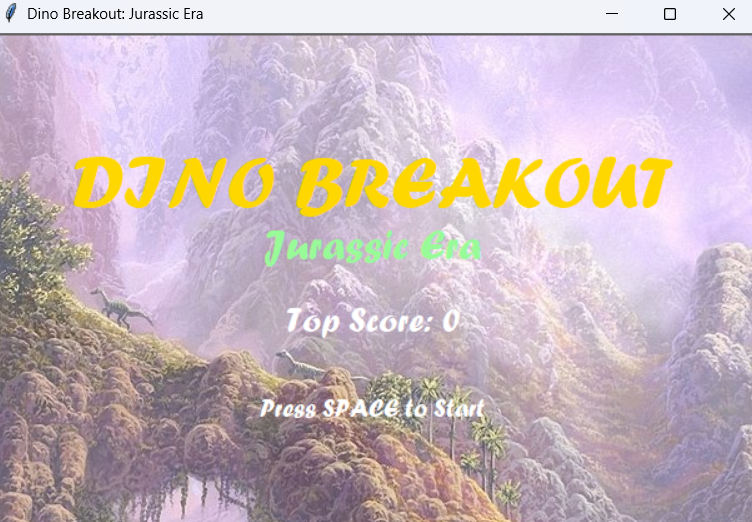
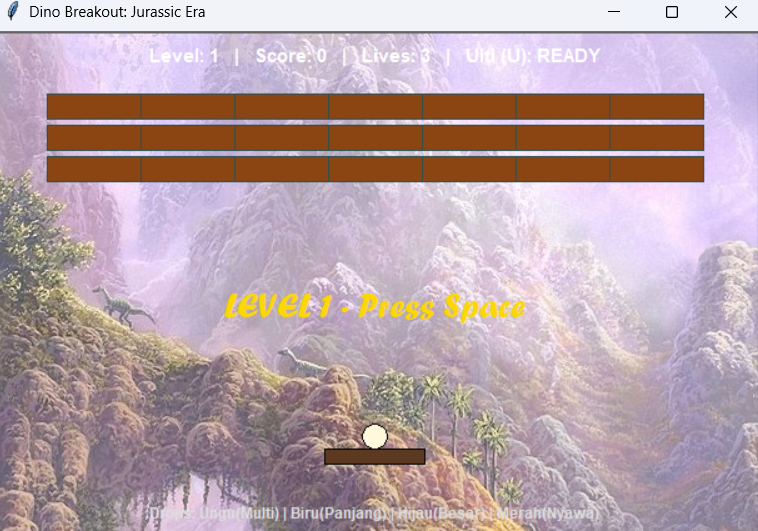

menu utama game

tampilan game

1. Penjelasan Singkat Game
Game ini adalah pengembangan dari genre klasik Breakout (pemecah bata) dengan tema Zaman Purba / Dinosaurus. Pemain mengendalikan sebatang kayu purba (paddle) di bagian bawah layar untuk memantulkan telur dinosaurus (ball) ke arah susunan bata yang merepresentasikan material purba (tanah, batu, dan fosil).

Tujuan permainannya adalah menghancurkan seluruh bata di setiap level tanpa membuat bola jatuh ke bawah layar, sembari mengumpulkan berbagai power-up (skill) yang berjatuhan untuk bertahan hidup dan meraih skor tertinggi (High Score).

2. Daftar Modifikasi dari Kode Awal
Berikut adalah perubahan dan peningkatan besar yang telah dilakukan secara bertahap dari kode dasar Anda:

Tema Visual & Latar Belakang: Mengubah warna latar belakang menjadi hijau hutan purba dan mendukung latar gambar (background image) bertema hutan (jungle) tanpa bug visual.

Sistem Level & Pola Dinamis: Menambahkan sistem level bertingkat (Level 1 hingga 5 memiliki pola bentuk khusus seperti Stegosaurus, Tengkorak T-Rex, Kawah Meteor, dan Jejak Kaki Dino). Mulai Level 6 ke atas, sistem akan mengacak pola bata secara otomatis (Endless Mode).

Pergerakan Paddle Lebih Mulus (60 FPS): Mengubah sistem kontrol tombol keyboard standar menjadi velocity/continuous loop (60 FPS) agar pergerakan papan kayu bebas dari jeda (stuttering).

Penyelesaian Bug Fisika Bola: Memperbaiki masalah bola yang sering "nyangkut" atau tembus menembus dinding dan paddle dengan menambahkan fungsi pantulan paksa.

Sistem Skor & High Score Permanen: Menambahkan pencatatan skor dinamis selama permainan serta menyimpan skor tertinggi secara otomatis ke dalam file teks eksternal (dino_highscore.txt) agar tidak hilang saat game ditutup.

Efek Visual Partikel Api (Fire Trail): Menambahkan efek buntut berapi yang dinamis di belakang bola dan tombak ultimate, lengkap dengan transisi gradasi warna (kuning ke oranye ke merah).

Integrasi Musik Latar Belakang (BGM): Menambahkan sistem audio menggunakan library Pygame untuk memutar musik latar bernuansa hutan secara berulang (looping).

3. Daftar Skill dan Fitur Spesial
Game ini dilengkapi dengan dua jenis kemampuan (skill): Skill Drop yang muncul secara acak saat bata hancur, dan Skill Ultimate bawaan pemain.

A. Skill Drop (Peluang 35% saat Bata Hancur)
🟣 Multi-Ball (Ungu): Mengeluarkan 2 bola tambahan sekaligus dari posisi paddle, membuat peluang menghancurkan bata jauh lebih cepat.

🔵 Long Paddle (Biru): Memperpanjang ukuran paddle secara signifikan untuk memudahkan pertahanan. Skill ini dilengkapi sistem Cooldown (durasi 10 detik) sebelum ukuran paddle kembali normal secara otomatis.

🟢 Large Ball (Hijau): Memperbesar ukuran radius telur dinosaurus (bola) sehingga area pukulannya menjadi lebih luas.

🔴 Extra Life / Nyawa Tambahan (Merah): Menambahkan jumlah nyawa (lives) Anda sebanyak +1 hati.

B. Skill Ultimate (Tombak Raksasa / Giant Spear)
Cara Penggunaan: Ditekan dengan menekan tombol U pada keyboard.

Efek: Meluncurkan tombak purba raksasa ke atas layar dari posisi paddle dengan kecepatan tinggi. Tombak ini mampu menghancurkan seluruh bata yang dilewatinya secara instan (1-hit KO), bahkan bata fosil terkeras sekalipun.

Cooldown: Memiliki waktu pendinginan (cooldown) selama 30 detik (status kesiapan dapat dilihat secara real-time melalui teks HUD di bagian atas layar: "READY" atau "CD [detik]").